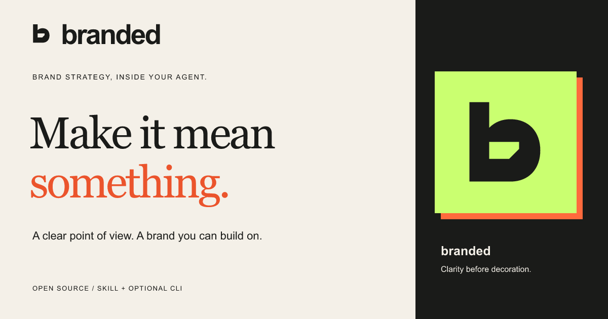

# branded



**A clear point of view. A brand you can build on.**

A portable branding workflow for lasting identities, temporary campaigns, and assets within established brands. Supports technology, food/hospitality, real estate and fashion/apparel, with B2B and packaging guidance. MIT licensed. Skill and CLI: `branded`.

[Homepage source](site/index.html) · [Brand playbook](site/brand-guide.html) · [Strategy and psychology](brand/identity/strategy.md) · [Read the workflow](SKILL.md)

## Install the skill

The workflow itself does not require Node, Git or a hosted server. Use a versioned portable skill folder or native plugin package through your agent's supported installation flow. See [native installation](docs/NATIVE_INSTALL.md) and [agent compatibility](docs/COMPATIBILITY.md).

Release packages are prepared by the build below. Public release availability and marketplace approval are separate; this repository does not imply a listing is already published.

## Optional CLI

The dependency-free CLI needs Node 18+. From a reviewed checkout, run its executable from your project or provide `--project` explicitly:

```sh
node /path/to/tech-branding-logo-repo/bin/branded.js install --agent codex
node /path/to/tech-branding-logo-repo/bin/branded.js install --agent claude --install-scope user
node /path/to/tech-branding-logo-repo/bin/branded.js install --agent grok --project /path/to/project
```

Choose **This project** for a shared or project-specific workflow, or **All my projects on this computer** for a personal installation. The CLI defaults to interactive selection; unattended installation requires an explicit host or target. `--global` is a working alias for personal scope. Installing a CLI executable globally is different from installing the skill personally.

The installer resolves a Git root when present; non-Git folders work too. `--project` chooses an exact root. Preview with `--dry-run`. It suggests detected hosts rather than installing into every tool it finds. Native, manually copied and CLI-managed installations have separate ownership; do not mix their update/removal controls without deliberate adoption.

```text
branded install      Install for a chosen host and scope
branded onboarding   Compatibility alias for install
branded doctor       Verify files; then check in your agent
branded update       Refresh saved targets, preserving edits
branded uninstall    Remove only unchanged tracked files
branded recover      Roll back an interrupted operation
branded brief        Create project memory (optional)
branded resume       Show current project progress
branded export       Export a portable brand kit
```

See [CLI installation and recovery](docs/INSTALLATION.md) for flags, records, custom paths, adoption, legacy migration and personal records. Unknown flags fail. `--force` never overwrites user edits. `.branding/` is preserved during uninstall.

## Moving from Tech Branding & Logo

The skill, CLI, package and new installation directories are now named `branded`. The GitHub repository URL stays the same. Existing `.branding/` project memory remains valid and is resumed without rewriting it. For an existing installation, follow the [rename guide](docs/INSTALLATION.md#moving-from-tech-branding--logo) to avoid duplicate skills.

## Use the workflow

Open your agent and ask it to use `branded` for the product, campaign or asset you need. It reads existing context, infers the work scope and asks only consequential unanswered questions. You can start in one compatible agent and continue in another using the same project files.

The agent can initialize memory from [templates/initialize-project.md](templates/initialize-project.md), without running the CLI. Alternatively run `brief` from the project. Both routes keep memory in the working project:

```text
.branding/
  context.md       Confirmed brief and open questions
  state.json       Scope, stage and progress
  handoff.md       Instructions for resuming
  decisions.md     Approved decisions and rejected directions
  inputs/          Supplied assets and references
  outputs/         Working artifacts
```

Resume by saying: “Read .branding/handoff.md and continue the brand project.” Personal skill installation does not move project state into your home skill directory or sync it to cloud services.

## One workflow, several installation adapters

`SKILL.md` and `references/` are the canonical expertise. The portable payload also includes schemas, the initialization template, optional OpenAI metadata and brand icons, and license. All distributions are built from that source; installation adapters do not maintain a competing branding methodology.

The CLI supports Codex, Claude Code, Grok coding agent, Cursor, Windsurf/Cascade, Gemini CLI and a generic/manual target. Grok Bot uses a separate private skill library. Discovery and execution depend on the exact host, session and available tools; see the [documented paths and pending live-host checks](docs/COMPATIBILITY.md). Missing image, vector, file or research tools must be disclosed rather than represented as completed production output.

Identity work retains `zero-to-brand`, `name-to-brand` and `brand-evolution` modes. Campaigns keep temporary overrides separate from master identity; applications use the existing identity without reopening naming or logo design. Industry modules are loaded selectively within one agent.

## Development and release preparation

```sh
npm ci
npm test
npm run validate
npm run build:release
```

The build produces a portable skill ZIP, native plugin ZIP, CLI tarball, release metadata and SHA-256 checksums in `dist/`. It does not publish anything. The plugin includes portable, Codex-compatible and Claude-compatible manifests. See [publishing guidance](PLUGIN_PUBLISHING.md).

Lifecycle tests cover edits, untracked files, repeated installs, saved targets, obsolete files, personal scope, legacy records, path/symlink escapes, rollback, recovery and CLI errors. Package tests inspect archives and run the packed CLI. CI is configured for macOS, Linux and Windows; live host discovery and branding quality require the separate manual checklist.

## Provenance and limitations

The legacy visual workflow draws on principles attributed in prior context to *Logos That Last*. The source PDF is not distributed; verified page claims or direct quotations are not made. New domain guidance is original and provisional. See [research method](references/research-method.md) and [evaluation scenarios](references/evaluation.md). Naming checks are preliminary and do not establish legal clearance.
